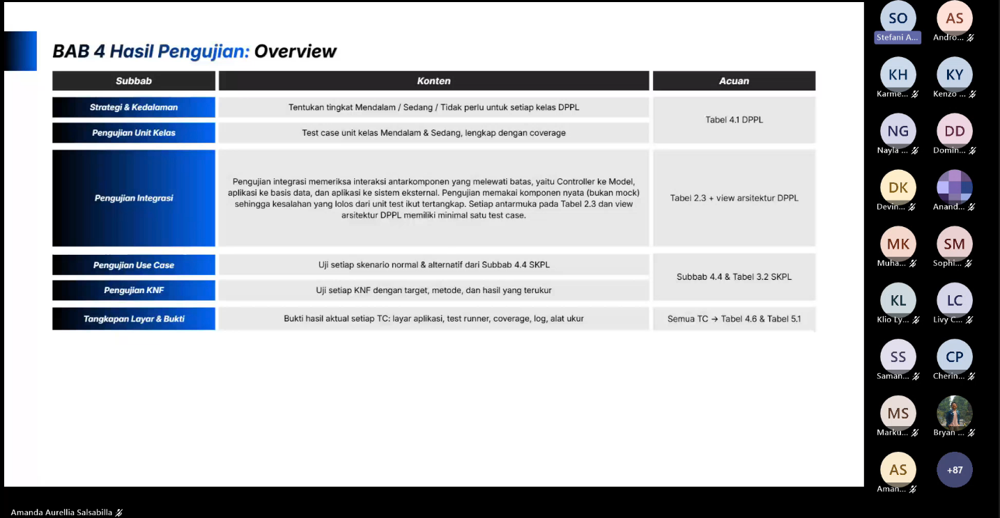

# Form Asistensi

## Tugas Besar IF2150 - Rekayasa Perangkat Lunak

| Informasi | Keterangan |
| --- | --- |
| **Hari** | *Senin* |
| **Tanggal** | *16/11/2026* |
| **Kelas** | K01 |
| **Nomor Kelompok** | G09 |
| **Nama Kelompok** | PindahCSUI |
| **Nama Perangkat Lunak** | PeerUP |
| **Dokumen** | Hasil Implementasi dan Uji Perangkat Lunak (HIUPL) |

### Anggota Kelompok

| NIM      | Nama                            |
| -------- | ------------------------------- |
| 13525049 | Hugo Daniel Johansen Napitupulu |
| 13525001 | Matthew Allen Reynaldo          |
| 13525010 | Fabian Amzar Susanto            |
| 13525025 | David Christian                 |
| 13525028 | Markus Christiano Simanjuntak   |

### Catatan

| Catatan |
| :--- |
| 1. Dokumen HIUPL terdiri atas logo dan identitas perangkat lunak, tabel Daftar Perubahan, serta lima bab: Pendahuluan, Deskripsi Umum Perangkat Lunak, Implementasi, Hasil Pengujian, dan *Traceability*. |
| 2. BAB 1 dan BAB 2 dapat disesuaikan dari dokumen sebelumnya. Istilah baru khusus HIUPL seperti TC, UT, INT, *boundary*, dan *coverage* perlu dijelaskan, aturan penomoran lama dipertahankan lalu ditambah pola ID *test case*, dan referensi minimal mencakup SKPL, APL, DPPL, dan Implementasi, ditambah dokumentasi *framework*, *library*, dan *testing tool*. |
| 3. BAB 2 memuat *system overview* dan *use case diagram* yang memperlihatkan aktor, batas sistem, dan sistem eksternal. Setiap gambar wajib disertai narasi yang menjelaskan isinya. |
| 4. BAB 3 mendokumentasikan hasil implementasi: lingkungan implementasi (termasuk *testing tools* yang dipakai), kelas yang diimplementasikan beserta nama berkasnya, layar yang telah jadi dengan ID antarmuka `I-XX` sesuai DPPL, serta berkas lain seperti konfigurasi, skema dan *seed* basis data, dan berkas pengujian. |
| 5. BAB 4 tidak cukup menyatakan bahwa fitur sudah berjalan, tetapi harus menyajikan hasil pengujian yang dapat diverifikasi. Pengujian manual dilakukan pada *use case* dan sebagian KNF dengan bukti tangkapan layar, sedangkan pengujian otomatis dilakukan pada pengujian unit dan integrasi. |
| 6. Setiap kelas DPPL diklasifikasikan berdasarkan ciri kelasnya menjadi Mendalam, Sedang, atau Tidak perlu. Kelas Mendalam (logika bisnis, perhitungan, validasi, algoritma, integrasi eksternal, keamanan) diuji pada setiap operasi *public* dengan minimal 3 *test case* (normal, *boundary*, *negative*) dan *coverage* ≥ 70%. Kelas Sedang diuji pada operasi *public* utama dengan minimal 2 *test case* dan boleh melalui pengujian integrasi. Kelas Tidak perlu cukup dicatat alasannya. Klasifikasi tidak perlu diperdebatkan berlebihan; yang penting alasannya masuk akal. |
| 7. *Coverage* dilaporkan per kelas Mendalam dalam bentuk % *line* dan % *branch* beserta bukti laporan dari *tool*. Apabila *coverage* belum mencapai target, *test case* boleh ditambahkan agar seluruh baris dan cabang terjalankan. |
| 8. Pengujian integrasi memeriksa interaksi antarkomponen yang melewati batas, yaitu *Controller* ke *Model*, aplikasi ke basis data, dan aplikasi ke sistem eksternal, menggunakan komponen nyata (bukan *mock*). Basis data uji yang terpisah dari basis data utama merupakan praktik terbaik; jika memakai basis data utama, data perlu dibersihkan kembali setelah pengujian. Data *dummy* di dalam berkas *test* yang tidak terhubung ke basis data juga diperbolehkan. |
| 9. Pengujian *use case* mencakup setiap skenario normal dan alternatif pada Subbab 4.4 SKPL, dengan minimal satu *test case* (`UCXX-TCYY`) per skenario yang berisi langkah, masukan, hasil yang diharapkan, hasil aktual, dan kesimpulan. |
| 10. Setiap KNF diuji dengan satu metode sesuai parameternya, target yang terukur, *tools* beserta jumlah pengulangan, hasil aktual berupa angka nyata, dan kesimpulan *Pass*/*Fail*. KNF yang tidak dapat diimplementasikan atau diukur tetap dicantumkan beserta justifikasi kendalanya. |
| 11. Setiap hasil *test case* harus didukung bukti aktual yang terbaca jelas pada Subbab 4.6: tangkapan layar aplikasi untuk *use case*, keluaran *test runner* dan laporan *coverage* untuk unit test, keluaran *test runner*, isi basis data, atau *log* untuk integrasi, serta tangkapan layar alat ukur untuk KNF. |
| 12. Pengujian mengacu pada kondisi implementasi terakhir. Perubahan kelas atau rancangan selama implementasi (misalnya kelas yang digabung) diuji sesuai implementasinya, dan seluruh perbedaan dari rancangan dicatat dalam dokumen. |
| 13. BAB 5 memetakan setiap KF ke KNF, *use case*, kelas perancangan, berkas implementasi, dan *test case*. Setiap KF memiliki minimal satu *test case* dan dinyatakan terpenuhi apabila seluruh *test case* terkaitnya *Pass*. KF yang tidak diimplementasikan tetap dicantumkan beserta alasannya. |
| 14. *Deadline* pengumpulan *draft* adalah 16 November 2026 pukul 21.00 WIB dan pengumpulan final adalah Jumat, 20 November 2026 pukul 21.00 WIB. |

## Dokumentasi

<!--  -->

  

  <i>Gambar 1. Dokumentasi kegiatan asistensi.</i>

