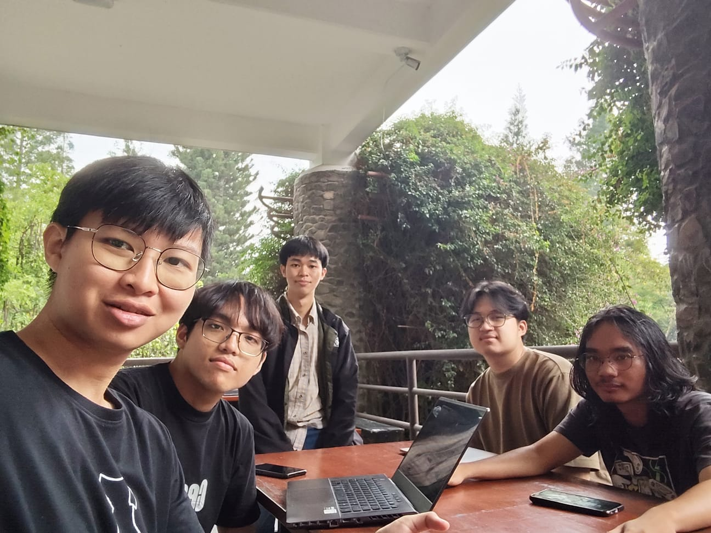

# Form Asistensi

## Tugas Besar IF2150 - Rekayasa Perangkat Lunak

| Informasi | Keterangan |
| --- | --- |
| **Hari** | *Selasa* |
| **Tanggal** | *27/10/2027* |
| **Kelas** | K01 |
| **Nomor Kelompok** | G09 |
| **Nama Kelompok** | PindahCSUI |
| **Nama Perangkat Lunak** | PeerUP |
| **Dokumen** | DESKRIPSI PERANCANGAN PERANGKAT LUNAK (DPPL) |

### Anggota Kelompok

| NIM | Nama |
| --- | --- |
| NIM      | Nama                            |
| -------- | ------------------------------- |
| 13525049 | Hugo Daniel Johansen Napitupulu |
| 13525001 | Matthew Allen Reynaldo          |
| 13525010 | Fabian Amzar Susanto            |
| 13525025 | David Christian                 |
| 13525028 | Markus Christiano Simanjuntak   |

### Catatan

| Catatan |
| :--- |
| 1. Dalam implementasi web berbasis PostgreSQL, *Entity Class* direpresentasikan sebagai tabel basis data. Metode CRUD yang semula berada pada *Entity Class* dapat dialihkan ke *Controller Class* untuk menangani operasi data. |
| 2. *Sequence Diagram* perlu disesuaikan dengan alur implementasi web: *Boundary* meneruskan input ke *Controller*, lalu *Controller* menjalankan operasi terhadap data. Pesan `create` dapat digunakan untuk menunjukkan pembuatan entitas atau baris data baru. |
| 3. Penulisan *pseudocode* harus dipisahkan dari *query* SQL. *Pseudocode* menjelaskan alur secara abstrak dan merujuk pada ID *query*, sedangkan rincian SQL ditulis dalam tabel *query* terpisah. |
| 4. Fungsi *wrapper* dapat digunakan sebagai perantara pemanggilan *query* SQL agar perubahan implementasi *query* tidak mengharuskan perubahan pada kode pemanggilnya. |
| 5. Pemilihan *architectural style/pattern* disesuaikan dengan pendekatan implementasi dan aspek sistem yang ingin dimodelkan. MVC dapat digunakan untuk memisahkan tanggung jawab dalam pendekatan OOP, sedangkan *Layered Architecture* atau *Client-Server* dapat membantu menggambarkan struktur aplikasi web. |
| 6. Penggunaan beberapa *architectural view* dapat memberikan perspektif berbeda terhadap sistem. Setiap *view* harus mempunyai tujuan yang jelas dan melengkapi view lainnya, bukan sekadar mengulang informasi yang sama. |
| 7. Perancangan perangkat lunak bersifat iteratif dan inkremental. Desain dapat disempurnakan pada setiap tahap, tetapi perlu ditetapkan titik ketika desain dianggap cukup agar pengembangan dapat dilanjutkan ke implementasi. |

## Dokumentasi

<!--  -->

  

  <i>Gambar 1. Dokumentasi kegiatan asistensi.</i>

