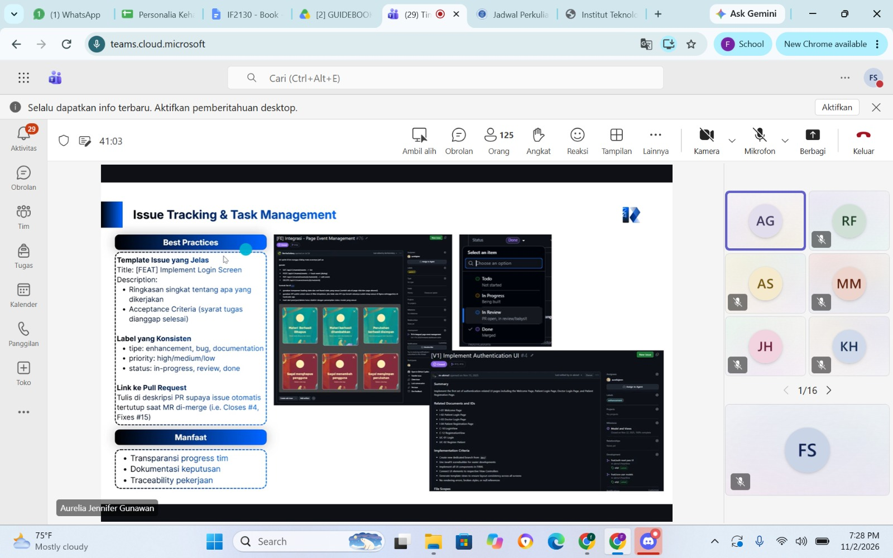

# Form Asistensi

## Tugas Besar IF2150 - Rekayasa Perangkat Lunak

| Informasi | Keterangan |
| --- | --- |
| **Hari** | *Senin* |
| **Tanggal** | *2/11/2026* |
| **Kelas** | K01 |
| **Nomor Kelompok** | G09 |
| **Nama Kelompok** | PindahCSUI |
| **Nama Perangkat Lunak** | PeerUP |
| **Dokumen** | Implementasi |

### Anggota Kelompok

| NIM      | Nama                            |
| -------- | ------------------------------- |
| 13525049 | Hugo Daniel Johansen Napitupulu |
| 13525001 | Matthew Allen Reynaldo          |
| 13525010 | Fabian Amzar Susanto            |
| 13525025 | David Christian                 |
| 13525028 | Markus Christiano Simanjuntak   |

### Catatan

| Catatan |
| :--- |
| 1. Laporan implementasi perlu mencakup perubahan dari rancangan DPPL sebelumnya, kendala selama pengerjaan, kontribusi setiap anggota, serta *traceability* antara rancangan kelas dan implementasinya. |
| 2. Teknik *profiling* dapat digunakan untuk mengidentifikasi fitur yang belum sesuai dengan rancangan. Penyebab ketidaksesuaian perlu ditelusuri, diperbaiki, kemudian diperiksa kembali hasilnya. |
| 3. Implementasi dilanjutkan pada repositori Git yang telah digunakan sebelumnya, dengan memanfaatkan folder `src`. README khusus implementasi dapat dibuat di dalam folder tersebut tanpa mengubah README bawaan repositori dari asisten. |
| 4. Pemilihan platform, bahasa pemrograman, dan *framework* dibebaskan selama sesuai dengan rancangan dan kebutuhan sistem. Dependensi perlu dicantumkan menggunakan berkas standar sesuai teknologi yang digunakan, sedangkan berkas instalasi yang tidak diperlukan dalam repositori dapat dikecualikan melalui `.gitignore`. |
| 5. README perlu menjelaskan kebutuhan instalasi, dependensi, layanan eksternal, serta langkah menjalankan aplikasi secara lengkap. Berkas `.env.example` cukup mencantumkan nama variabel lingkungan tanpa memasukkan nilai kredensial atau *API key* yang sebenarnya. |
| 6. Penggunaan basis data disesuaikan dengan kebutuhan sistem. SQLite atau Docker Compose dapat digunakan sebagai alternatif penyimpanan lokal, sedangkan CSV atau JSON sudah dapat mencukupi apabila data yang digunakan bersifat *dummy* atau jarang mengalami perubahan. |
| 7. Struktur folder dan kode perlu disesuaikan dengan arsitektur yang telah dirancang. Pada MVC, *Model* menangani data dan logika terkait, *View* berfokus pada tampilan dan meneruskan interaksi kepada *Controller*, sedangkan *Controller* menghubungkan keduanya serta menangani alur aplikasi. |
| 8. Folder `test` dapat digunakan untuk menyimpan *test case*. Pengujian juga disarankan untuk dilakukan pada setiap modul, fungsi, atau kelas melalui *unit testing* dengan berkas pengujian tersendiri. |
| 9. README minimal perlu memuat deskripsi aplikasi, teknologi beserta versinya, kebutuhan instalasi, dependensi, dan cara menjalankan program. Informasi tambahan seperti perintah yang diperlukan, akun pengujian, data uji, serta skema basis data juga perlu dicantumkan apabila digunakan. |
| 10. Pengelolaan kode disarankan menggunakan *Git Flow*: `main` untuk kode yang siap dirilis, `develop` untuk integrasi fitur, `feature` untuk pengembangan fitur secara independen, `release` untuk persiapan rilis dan pengujian akhir, serta `hotfix` untuk perbaikan mendesak pada kode produksi. |
| 11. Pengembangan fitur dilakukan pada *branch* yang dibuat dari `develop`. Perubahan terbaru dari `develop` perlu diambil secara berkala, kemudian fitur diuji sebelum diajukan melalui *Pull Request*. Setiap *Pull Request* harus ditinjau oleh anggota lain dan tidak boleh ditinjau maupun digabungkan sendiri oleh pembuatnya. |
| 12. Format *commit message* disarankan mengikuti pola `type(scope): description`, dengan *body* sebagai bagian opsional. Jenis perubahan yang dapat digunakan meliputi `feat`, `fix`, `docs`, `style`, `refactor`, `test`, dan `chore`. |
| 13. *GitHub Issues* dapat digunakan untuk pembagian tugas, pemantauan perkembangan pekerjaan, dan dokumentasi keputusan tim. Setiap *issue* sebaiknya memiliki judul, deskripsi, *acceptance criteria*, label, prioritas, dan status yang jelas. *Issue* juga dapat dihubungkan dengan *Pull Request* agar penyelesaiannya terdokumentasi. |
| 14. *Code review* perlu memperhatikan kesesuaian kode dengan kebutuhan fungsional dan nonfungsional, kemungkinan kesalahan logika, kejelasan penamaan, serta kualitas kode. Hasil peninjauan dapat berupa persetujuan, permintaan perubahan, atau diskusi lebih lanjut. Pemeriksaan gaya penulisan dapat dibantu oleh *linter* atau *formatter*. |
| 15. Implementasi sebaiknya dimulai dengan memastikan fitur dapat berjalan, kemudian dilanjutkan dengan pengujian dan identifikasi bagian yang menjadi hambatan performa. Setelah hambatan ditemukan, optimasi dapat dilakukan pada bagian yang memang memerlukannya. Pemeriksaan sebelum *Pull Request* setidaknya mencakup fungsionalitas, keterbacaan kode, performa, keamanan, dan pengujian. |
| 16. Beberapa praktik yang perlu dihindari meliputi *God Class* atau *God Function*, penggunaan nilai yang di-*hardcode*, penanganan kesalahan yang tidak informatif, pencampuran tanggung jawab, dan gaya penulisan kode yang tidak konsisten. Pemisahan tanggung jawab, penggunaan berkas konfigurasi atau *environment variable*, serta konvensi penamaan yang disepakati dapat membantu menghindari masalah tersebut. |
| 17. Implementasi perlu didasarkan pada Kebutuhan Fungsional (KF) yang telah ditetapkan. Untuk Kebutuhan Non-Fungsional (KNF), pemenuhan batas minimum yang ditentukan dapat diprioritaskan. Keduanya menjadi dasar pemeriksaan saat demonstrasi, sehingga persiapan presentasi atau *pitching* juga perlu dilakukan. |

## Dokumentasi

<!--  -->

  

  <i>Gambar 1. Dokumentasi kegiatan asistensi.</i>

